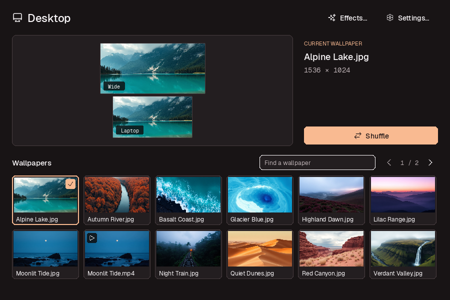
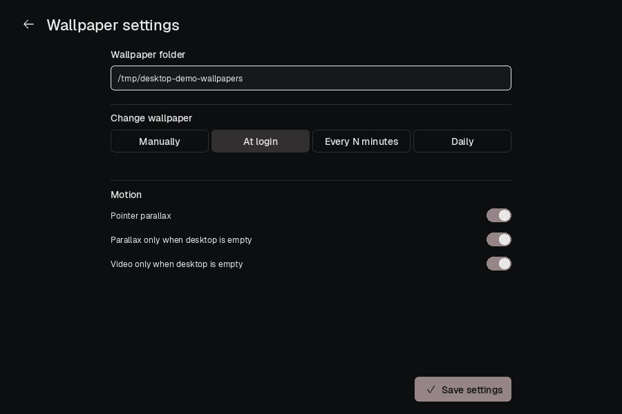

# Desktop

Image and video wallpapers for X11. Desktop is a C11 session daemon, CUI wallpaper picker, and command-line tool in one executable.



## Install

Install or upgrade the latest release for Linux x86-64 or ARM64.

```sh
curl -fsSL https://raw.githubusercontent.com/mattmezza/desktop/main/install.sh | sh
```

The installer verifies the release checksum and installs into `~/.local` by default. Set `PREFIX` to install elsewhere, or `DESKTOP_VERSION=v0.1.1` to pin a release. Put the installation's `bin` directory on your PATH. The archive includes static Desktop, FFmpeg, and FFprobe executables. It preserves existing configuration on upgrades.

For a source build, install a C toolchain, pkg-config, Xlib, XRandR, XRender, XFixes, Xext, XScreenSaver, FreeType, HarfBuzz, libpng, libjpeg-turbo, and libwebp development files. CUI and the Geist faces are bundled. Use `ffmpeg` and `ffprobe` from PATH for video.

```sh
sudo make clean install
# Or install under your user account.
make install PREFIX="$HOME/.local"
```

## Use

Run `desktop` to browse and apply wallpapers. Select a tile to see the crop on each active output, then choose **Set wallpaper**. **Shuffle** applies a new eligible wallpaper. Search by filename, use the page arrows or the scroll wheel, and press **Esc** to go back or close.

In **Settings…**, choose your folder, rotation schedule, and when each motion effect plays. Rotation can be manual, once at X login, every N minutes, or once per local calendar day.



Desktop supports JPEG, PNG, and WebP images, plus local video in formats including MP4, WebM, MOV, and MKV. Videos loop muted. Desktop crops the same source for each output and skips media smaller than any output, with extra headroom for image parallax. If a new monitor makes the current wallpaper ineligible, Desktop can use an eligible temporary choice and restore your selection when it fits again.

## Session and launcher

Add `desktop login` to your X session startup, such as `~/.xinitrc`, before starting the window manager. The command starts the daemon, applies your login choice, and runs the optional `after_login` hook synchronously. The daemon listens for RandR changes. For [Undocked](https://github.com/mattmezza/undocked), also use its settled-layout hook.

```ini
[undocked]
after_change = desktop reapply
```

For [Launch](https://github.com/mattmezza/launch), add a workflow to its `config.ini`. Use `desktop launch` as the command if you prefer an action picker for opening Desktop, shuffling, and pausing or resuming rotation.

```ini
[workflow Desktop]
keywords=wallpaper wallpapers background appearance images photos video live parallax shuffle rotation
command=desktop
```

The settings window uses `WM_CLASS` of `desktop` / `Desktop` and the EWMH dialog type, so [mwm](https://github.com/mattmezza/mwm) floats and centers it. An empty-desktop menu in your window manager can bind **Desktop…** to `desktop`.

## Configure and script

Copy [config.ini](config.ini) to `${XDG_CONFIG_HOME:-$HOME/.config}/desktop/config.ini` or print its complete defaults with `desktop config defaults`. Settings writes keep comments and follow a stowed symlink. The applied selection and pause state live under `${XDG_STATE_HOME:-$HOME/.local/state}/desktop`.

Empty theme values inherit `desktop.*` Xresources, the mwm palette, then the bundled defaults. Use `desktop.background`, `desktop.panel`, `desktop.foreground`, `desktop.muted`, `desktop.border`, `desktop.accent`, `desktop.onAccent`, `desktop.cornerRadius`, `desktop.font`, or `desktop.mono`. Explicit INI values take priority. The bundled fonts are Geist and Geist Mono.

When enabled for an effect, **only when desktop is empty** eases it to a stop when an application window becomes visible on any active output. On mwm, clients on hidden tags are off-screen and count as hidden. Video freezes on its last frame and resumes from there. Pointer parallax returns to the neutral crop. Desktop observes X11 blanking and DPMS. A locker can also explicitly inhibit motion for its lifetime.

```sh
desktop status --json
desktop list --json
desktop set "$HOME/Pictures/Wallpapers/alpine.jpg"
desktop next
desktop pause
desktop resume
desktop reapply
desktop config set parallax.travel_px 10
desktop config set video.empty_only false
desktop config check
desktop reload
desktop inhibit -- lok
```

The JSON commands carry a schema version. Errors use stderr and nonzero exit status. See `desktop --help` for all commands.

## Build and release

Run `make check` with Xvfb, xauth, xdotool, X11 utilities, FFmpeg, and Python 3. Set `TEST_WM` to the path to an mwm executable to run the same checks under it.

```sh
make release name=v0.1.0
```

From a clean commit pushed to `origin/main`, this pushes an annotated tag. GitHub Actions builds both architectures, verifies static linkage, runs the X11 checks, and publishes the binaries, installer archives, checksums, and corresponding FFmpeg source.

Desktop is MIT-licensed. It uses [CUI](https://github.com/mattmezza/cui), [Geist](https://vercel.com/font), and [Heroicons](https://heroicons.com/). The bundled video helpers use [FFmpeg](https://ffmpeg.org/) under LGPL 2.1 or later. The screenshots use generated demonstration wallpapers.
