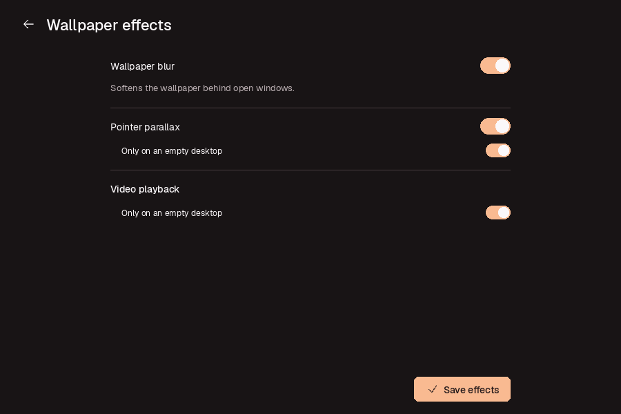

# Desktop

Image and video wallpapers for X11. Desktop is a C11 session daemon, CUI wallpaper picker, and command-line tool in one executable.


## Install

Install or upgrade the latest release for Linux x86-64 or ARM64.

```sh
curl -fsSL https://raw.githubusercontent.com/mattmezza/desktop/main/install.sh | sh
```

The installer verifies the release checksum and installs into `~/.local` by default. Set `PREFIX` to install elsewhere, or `DESKTOP_VERSION=v0.1.5` to pin a release. Put the installation's `bin` directory on your PATH. The archive includes static Desktop, FFmpeg, and FFprobe executables. It preserves existing configuration on upgrades.

For a source build, install a C toolchain, pkg-config, Xlib, XRandR, XRender, XFixes, Xext, XScreenSaver, FreeType, HarfBuzz, libpng, libjpeg-turbo, and libwebp development files. CUI and the Geist faces are bundled. Use `ffmpeg` and `ffprobe` from PATH for video.

```sh
sudo make clean install
# Or install under your user account.
make install PREFIX="$HOME/.local"
```

## Use

Run `desktop` to browse and apply wallpapers. Select a tile to see the crop on each active output, then choose **Set wallpaper**. **Shuffle** applies a new eligible wallpaper. Filter by **Images** or **Videos**. **Hide unsuitable** starts checked and shows only wallpapers that fit your connected displays and current effects settings. Clear it to see the entire library, or set `ui.hide_unsuitable = false` to start with it cleared. Search by title, filename, tags, description, or credits. Each search word can match a different field. Use the page arrows or scroll wheel to browse, and press **Esc** to go back or close.

In **Settings…**, choose your folder and rotation schedule. Rotation can be manual, once at X login, every N minutes, or once per local calendar day. Open **Effects…** to control wallpaper blur, pointer parallax, and when videos play.



Desktop supports JPEG, PNG, and WebP images, plus local video in formats including MP4, WebM, MOV, and MKV. Videos loop muted. Desktop crops the same source for each output and skips media smaller than any output, with extra headroom for image parallax. If a new monitor makes the current wallpaper ineligible, Desktop can use an eligible temporary choice and restore your selection when it fits again.

## Package a wallpaper

Each package is one folder containing a `wallpaper.ini` descriptor, a thumbnail, and the source media. Desktop finds packages directly inside your wallpaper library, alongside loose images and videos. Enable `library.recursive` to find packages in subfolders too.

1. From the directory containing your image or video, run `desktop pack` with the source file and a new folder under your library. The command copies the media unchanged, generates `thumbnail.webp`, and writes a descriptor for you.

   ```sh
   desktop pack lake.mp4 "$HOME/.config/wallpapers/lake"
   ```

2. Edit the new folder's `wallpaper.ini` to add a title, searchable tags, and credits or change video speed. This descriptor plays the lake video at quarter speed.

   ```ini
   [wallpaper]
   version = 1
   type = video
   title = Lake at dawn
   tags = nature, water, sunrise
   thumbnail = thumbnail.webp

   [video]
   file = lake.mp4
   speed = 0.25
   ```

3. Reopen the chooser to pick the wallpaper, or apply the package from the command line.

   ```sh
   desktop set "$HOME/.config/wallpapers/lake"
   ```

For a still image, use `type = image` and put `file` under `[image]`. For a video, use `type = video` and put `file` and optional `speed` under `[video]`. Speed ranges from `0.05` to `4` and defaults to `1`. The pause and resume ramps ease between a standstill and the package's speed. Optional `[wallpaper]` fields include `description`, `author`, `source`, and `license`. Keep media and thumbnail paths relative to the package folder. Desktop can derive a preview from the source if the thumbnail is missing or unreadable.

Applying a package reads the descriptor again. Use `desktop reload` to refresh the daemon's library and reapply the current selection after an edit.

`desktop status` prints the media file for existing scripts. Use `desktop status --path` for the package or loose-file path and `desktop list --json` for package metadata. Hooks can read `DESKTOP_PACKAGE` when the active wallpaper has a package.

## Session and launcher

Add `desktop login` to your X session startup, such as `~/.xinitrc`, before starting the window manager. The command starts the daemon, applies your login choice, and runs the optional `after_login` hook synchronously. The daemon listens for RandR changes. For [Undocked](https://github.com/mattmezza/undocked), also use its settled-layout hook.

```ini
[undocked]
after_change = desktop reapply
```

For [Launch](https://github.com/mattmezza/launch), add a workflow to its `config.ini`. Use `desktop launch` as the command if you prefer an action picker for opening Desktop, shuffling, and pausing or resuming rotation.

```ini
[workflow Desktop]
keywords=wallpaper wallpapers background appearance images photos video live parallax shuffle rotation
command=desktop
```

The settings window uses `WM_CLASS` of `desktop` / `Desktop` and the EWMH dialog type, so [mwm](https://github.com/mattmezza/mwm) floats and centers it. An empty-desktop menu in your window manager can bind **Desktop…** to `desktop`.

## Configure and script

Copy [config.ini](config.ini) to `${XDG_CONFIG_HOME:-$HOME/.config}/desktop/config.ini` or print its complete defaults with `desktop config defaults`. Settings writes keep comments and follow a stowed symlink. The applied selection and pause state live under `${XDG_STATE_HOME:-$HOME/.local/state}/desktop`.

Empty theme values inherit `desktop.*` Xresources, the mwm palette, then the bundled defaults. Use `desktop.background`, `desktop.panel`, `desktop.foreground`, `desktop.muted`, `desktop.border`, `desktop.accent`, `desktop.onAccent`, `desktop.cornerRadius`, `desktop.font`, or `desktop.mono`. Explicit INI values take priority. The bundled fonts are Geist and Geist Mono.

- **Wallpaper switching** fades through black using XRender, which can use GPU acceleration when your X11 driver supports it. `layout.fade_ms` sets the total duration for both halves. It defaults to 480 ms and accepts 0 to switch immediately. Existing `layout.crossfade_ms` settings are read as the same duration.
- **Wallpaper blur** softens images and videos behind open windows and reveals the sharp wallpaper when the display is empty. Both directions start slowly and accelerate toward the end. The default is a 24 px Gaussian blur with a 1.5-second transition. Adjust `blur.radius_px`, `blur.transition_ms`, or `blur.easing_power` (1 for linear, 3 for cubic).
- **Pointer parallax** filters quick cursor reversals and retains the displayed pixel position during small movements. By default it travels up to 5 px from center on each axis at up to 15 px/s. Tune `parallax.travel_px`, `parallax.ease_ms`, and `parallax.max_speed_px_s`. With **Only on an empty desktop** enabled, it settles back to center on occupied outputs.
- **Video playback** eases to a stop on occupied outputs and gradually resumes from the held frame when **Only on an empty desktop** is enabled. `video.ramp_ms` sets the duration and `video.ramp_power` sets the easing strength from 1 (linear) to 6 (strongest), with 3 (cubic) by default.

Effects follow each display independently. On mwm, windows on hidden tags are off-screen and count as hidden. Desktop observes X11 blanking and DPMS. A locker can also explicitly inhibit motion for its lifetime.

```sh
desktop status --json
desktop list --json
desktop set "$HOME/Pictures/Wallpapers/alpine.jpg"
desktop next
desktop pause
desktop resume
desktop reapply
desktop config set parallax.travel_px 4
desktop config set blur.radius_px 18
desktop config set video.empty_only false
desktop config check
desktop reload
desktop inhibit -- lok
```

The JSON commands carry a schema version. `status --json` reports the configured video multiplier as `playback_speed` and the effective multiplier during motion as `video_speed`. Each output also reports its effective `video_speed` and blur radius. Errors use stderr and nonzero exit status. See `desktop --help` for all commands.

## Build and release

Run `make check` with Xvfb, xauth, xdotool, X11 utilities, FFmpeg, and Python 3. Set `TEST_WM` to the path to an mwm executable to run the same checks under it.

```sh
make release name=v0.1.0
```

From a clean commit pushed to `origin/main`, this pushes an annotated tag. GitHub Actions builds both architectures, verifies static linkage, runs the X11 checks, and publishes the binaries, installer archives, checksums, and corresponding FFmpeg source.

Desktop is MIT-licensed. It uses [CUI](https://github.com/mattmezza/cui), [Geist](https://vercel.com/font), and [Heroicons](https://heroicons.com/). The bundled video helpers use [FFmpeg](https://ffmpeg.org/) under LGPL 2.1 or later. The screenshots use generated demonstration wallpapers.
